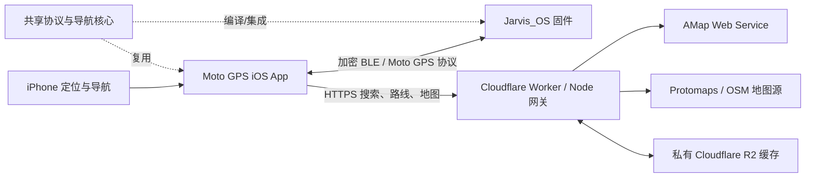

# Jarvis_OS 系统架构

当前实现以本文件、`firmware/jarvis_os/` 和 `packages/moto-gps/shared/` 为准。旧方案保留在 `docs/design/history/` 或 `archive/legacy-jarvis/`，不代表当前产品行为。

## 系统组成

| 层 | 职责 | 主要目录 |
|---|---|---|
| 圆屏固件 | 启动、锁屏/表盘、设置、触摸和按键、IMU、Moto GPS UI 与 BLE | `firmware/jarvis_os/` |
| iOS App | 定位、地点搜索、路线/地图、离线缓存、媒体控制、BLE 外设连接 | `apps/ios/moto-gps/` |
| 网关服务 | 搜索、路线、城市、地图瓦片代理与缓存 | `services/moto-gps-gateway/` |
| 共享协议与导航 | BLE 帧、坐标、导航状态机、Presenter/UI 和地图数据 | `packages/moto-gps/shared/` |
| 调试 | 圆屏/IMU BLE 调试器、Moto GPS 浏览器模拟器与 USB 实屏预览 | `tools/debug/` |

固件不连接地图网关或 Wi-Fi。iOS App 负责联网、路线规划与地图下载，再经 BLE 发送设备显示所需状态；共享协议用于保持两端消息格式与导航状态一致。

## 固件模块和生命周期

- `main/main.c` 执行 NVS、时钟、显示、输入、电源和设备传感器初始化，并启动启动界面。
- `main/launcher.c` 注册当前固件应用：设置、表盘和 MOTO GPS。固件中不登记 OTA、Web 或旧 Codex/Travel 应用。
- 应用沿用 `app_t` 生命周期，页面进入、遮挡、恢复和退出应维护 timer、触摸可见性及资源释放。
- `main/app_moto_gps.cpp` 管理导航 Presenter、UI、设备 IMU 航向辅助与 BLE 传输。
- `main/ble_nav_transport_nimble.cpp` 提供 Jarvis_OS 的 MOTO GATT 服务；协议状态机、坐标、Presenter 和导航 UI 复用 `packages/moto-gps/shared/`。
- 显示目标为 466 × 466 圆屏。重要文字和触控目标须落在可视安全区域，保持黑底、白灰文字与红色强调。

## BLE 连接与数据边界

- iOS App 为定位和导航状态的主数据源；固件只显示通过当前版本 BLE 协议验证后的消息。
- BLE 消息需要完成长度、序号、会话和载荷校验；不完整帧与旧连接快照不能覆盖当前导航状态。
- 连接或导航超时需清理设备页上的位置和路线状态，明确显示断开/过期状态。
- 设备 BLE 配对信息与设置位于 NVS；更新时不初始化擦除 NVS。
- 当前 Jarvis GeekTwin 工具使用旧 IMU 服务 UUID 和 20-byte 帧，和 Moto GPS GATT 不相同；将其重连到当前固件前必须做协议兼容工作。

## iOS 与服务端

- App 网关地址由 `apps/ios/moto-gps/project.yml` 提供默认值，并可在 App 设置中覆盖。
- 搜索、路线、行政区划和在线地图请求由 `services/moto-gps-gateway/` 提供；Cloudflare Worker 与 Node 服务共享处理逻辑。
- Cloudflare 部署配置位于 `services/moto-gps-gateway/cloudflare/wrangler.jsonc`，R2 仅用于地图缓存。
- `AMAP_WEB_SERVICE_KEY` 是 Worker Secret，不进入 App、设备固件、Wrangler vars 或 Git。
- Cron 当前配置为 UTC `17 3 * * *`，用于地图源元数据刷新；它不是固件升级服务。

## 电源与设备数据

- AOD、亮度和语言使用现有设置/NVS 接口；不要改已有键名或值格式。
- 保持 `app_t` 与锁屏遮挡的 visibility、tick 和退出清理语义。
- 只刷新应用槽的固件安装不触碰 NVS、分区表、storage、capsule_meta 或 capsules。
- 改分区表、格式或录音数据模型之前必须先制定备份与迁移步骤。本次不改分区布局。

## 历史保留与验证

- `Jarvis_OS/UPSTREAM.md`、`Jarvis_OS/UPSTREAM_README.md` 和英文版说明是 soRound_os 来源/历史材料，保留其原位置。
- 旧实现按来源和许可要求放入 `archive/legacy-jarvis/`，不纳入当前固件 CMake 源文件或发布包。
- 固件构建、iOS 开发、Worker 部署和真机调试分别见 `docs/development/`、`docs/deployment/` 与 `docs/debugging/`。
- 主机/模拟器构建通过不代表已验证 iPhone BLE、后台定位、地图服务、触摸、休眠或音乐控制。
